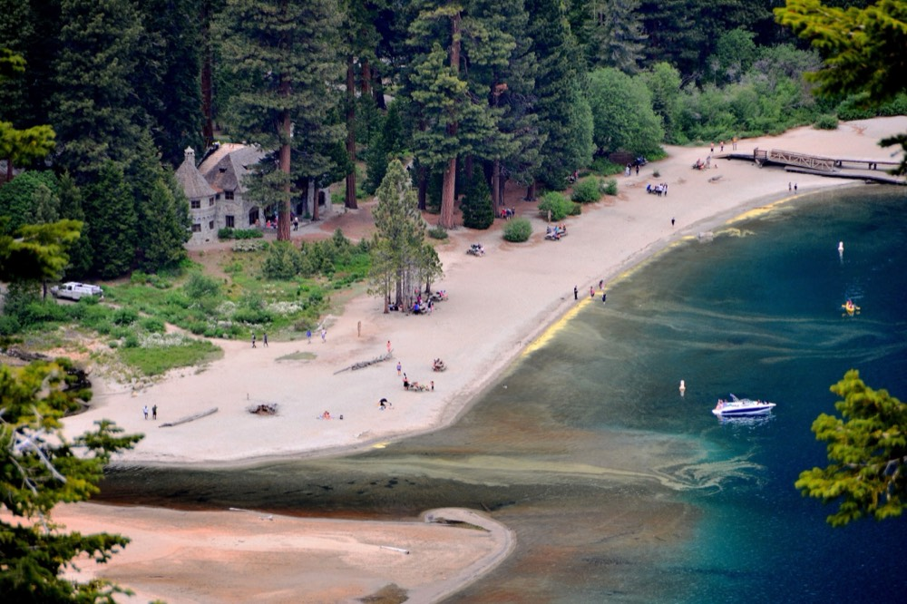
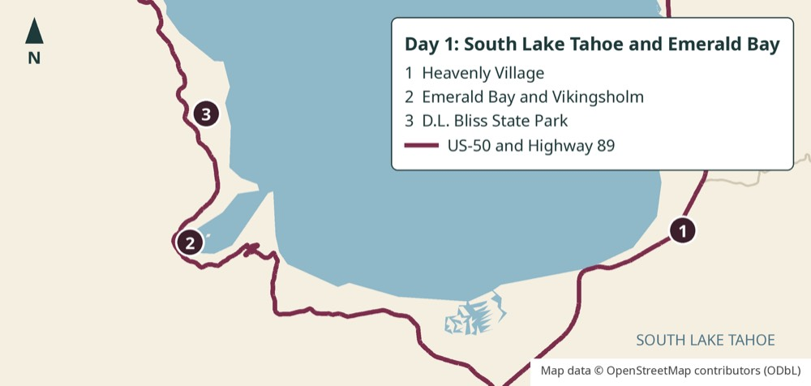
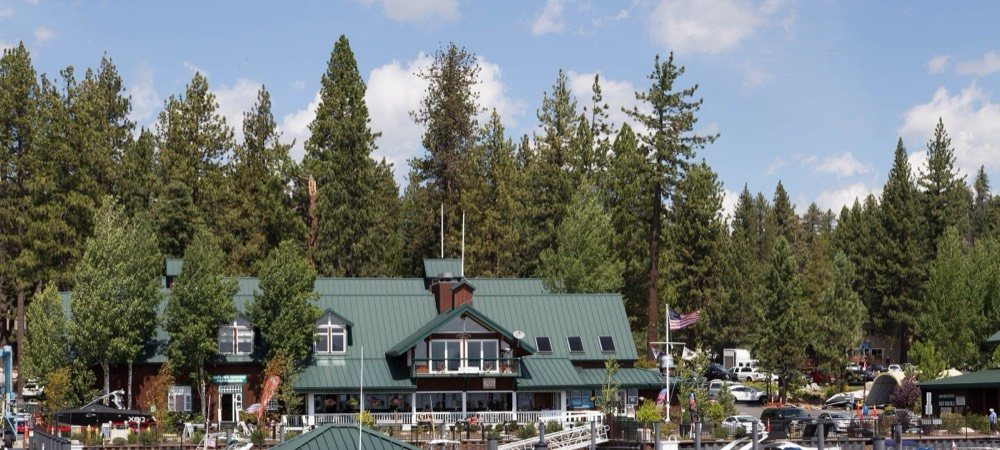
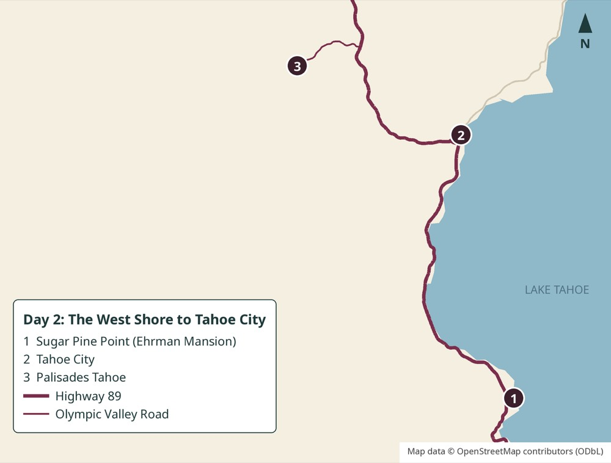
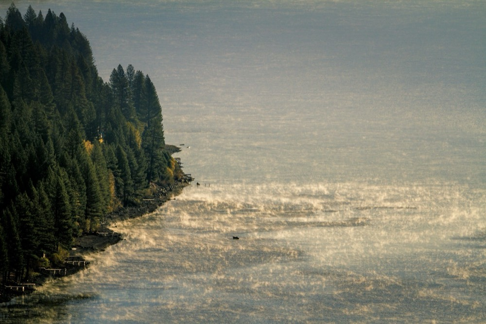
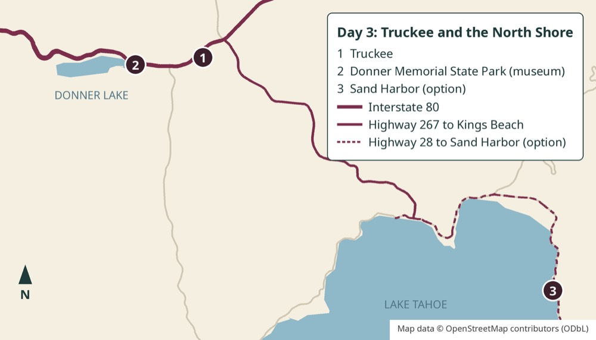

% Lake Tahoe in 3 Days
% TheTripNow

# At a glance

| Day | Where | Main stops |
|---|---|---|
| **1** | South Lake Tahoe and Emerald Bay | Heavenly Village and the gondola; Emerald Bay and Vikingsholm; D.L. Bliss State Park and the Rubicon Trail |
| **2** | The West Shore to Tahoe City | Sugar Pine Point and the Ehrman Mansion; Tahoe City and the Gatekeeper's Museum; Palisades Tahoe |
| **3** | Truckee and the North Shore | Truckee's Commercial Row; Donner Memorial State Park. Option: Sand Harbor |

## Drive times (about; traffic varies)

- San Francisco to South Lake Tahoe: roughly 3.5–4 hours by car.
- San Francisco to Truckee, on I-80: about 187 miles.

## Book ahead, or check first

- Sand Harbor, April 15 to October 15: a day-use reservation to drive in between 8 and 10:30 am.
- Vikingsholm and Ehrman Mansion house tours run in summer only, and are first come, first served.
- Winter: Highway 89 at Emerald Bay closes after storms, and chains may be required.

# Lake Tahoe in 3 Days

This guide is for first-time and returning visitors who want three easy days around the lake: beaches and a castle in the south, quiet parks on the West Shore, and an old railroad town in the mountains to finish.

## The 3-day shape

- **Day 1:** South Lake Tahoe and Emerald Bay.
- **Day 2:** the West Shore to Tahoe City.
- **Day 3:** Truckee and the North Shore.

## Getting there

South Lake Tahoe is about 3.5–4 hours by car from San Francisco. The routes, the winter roads and getting around without a car are in Practical Matters.

## The lake

Lake Tahoe is about 1,645 ft deep at its deepest point, the second-deepest lake in the US after Oregon's Crater Lake. Its surface sits about 6,225 ft above sea level, with about 72 miles of shoreline.

> **Did you know?** Scientists have measured the lake's clarity with a white disk since 1968: about 102 ft deep that first year, and about 72 ft as the 2022 average.

## When to go

Summer is the busiest season. In fall, the aspens of Hope Valley on Highway 88 turn yellow, usually best in early to late October, though it varies by year, so check before you go. Winter is ski season at Palisades and Heavenly. Weekdays are quieter all year.

Prices, hours and seasons change, so check before you go.

# Day 1: South Lake Tahoe and Emerald Bay

*Vikingsholm, Emerald Bay. Photo: Mike McBey · CC BY 2.0 · Wikimedia Commons*

{.day-map}

## Stateline and the Heavenly Gondola

Start at Heavenly Village, where the California–Nevada line crosses US-50. On the Nevada side, Stateline's casino hotels are all a short walk from the village. The Heavenly Gondola climbs from the village plaza; summer sightseeing ran about 10 am to 5 pm daily in 2025; hours change each year, so check before you go, and see skiheavenly.com for tickets.

## Emerald Bay and Vikingsholm

Drive Highway 89 north to Emerald Bay. Vikingsholm sits at the water at the end of a steep 1-mile trail from the lot on Highway 89; a gentler 1.5-mile trail starts at Eagle Point Campground. Parking is about $10 per vehicle per day or $3 per hour, sunrise to sunset, and the lot fills and can close in peak season; then park at Eagle Falls or D.L. Bliss. House tours ran daily from May 23 to September 30 in 2026, every half hour from 10:30 am to 4 pm, first come, first served, about $18 for adults. Dogs aren't allowed on the Vikingsholm trails.

> **Did you know?** Lora Knight bought the bay in 1928 and built the 38-room Scandinavian-style house in 1929 with about 200 workers. She also had a small stone teahouse built on Fannette Island, the lake's only island.

In winter, this stretch of Highway 89 can close after storms; see the winter box in Practical Matters.

## D.L. Bliss State Park and the Rubicon Trail

Just north of Emerald Bay, D.L. Bliss State Park reopened for camping and day use on May 21, 2026. Day use runs sunrise to sunset, about $10 per vehicle, and from October 1 the park is open to walkers only. The Rubicon Trail follows the shore toward Emerald Bay; dogs aren't allowed on the beach or trails.

## Where to stay

- **Basecamp Hotel** (budget, [$]{.nowrap}): stylish, two blocks from Heavenly Village.
- **The Coachman Hotel** (mid, [$$]{.nowrap}): renovated in 2021.
- **Camp Richardson Historic Resort** (mid, [$–$$]{.nowrap}): hotel, cabins and a beach on the lake between town and Emerald Bay.
- **Edgewood Tahoe Resort**, Stateline (upper, [$$$]{.nowrap}): lakefront, with a golf course; resort fee.

## Where to eat

- **Ernie's Coffee Shop** ([$]{.nowrap}): breakfast and lunch since 1968.

Prices, hours and seasons change, so check before you go.

# Day 2: The West Shore to Tahoe City

*Tahoe City, on the north-west shore. Photo: Bohao Zhao · CC BY 3.0 · Wikimedia Commons (cropped)*

{.day-map}

## Sugar Pine Point and the Ehrman Mansion

Head north up the West Shore to Ed Z'berg Sugar Pine Point State Park and the Hellman-Ehrman Mansion, built in 1903. House tours ran daily from May 23 to September 30 in 2026, on the half hour from 10:30 am to 3:30 pm, about 45 minutes each, first come, first served. Check the tour price before you go.

In winter, check the road first; see the winter box in Practical Matters.

## Tahoe City and the Gatekeeper's Museum

In Tahoe City, the Gatekeeper's Museum stands beside the Lake Tahoe Dam, where the Truckee River leaves the lake, its only outlet. It's open about April 1 to October 31, Wednesday to Sunday, 11 am to 4 pm, and by appointment in winter; the Marian Steinbach Indian Basket Museum is part of it.

> **Did you know?** The museum's first cabin housed the gatekeeper, who set how much water flowed out of the lake.

## Palisades Tahoe

North of Tahoe City, Olympic Valley is home to Palisades Tahoe. It was renamed Palisades Tahoe on September 13, 2021, after consultation with local Washoe groups.

> **Did you know?** The valley hosted the 1960 Winter Olympics.

## Where to stay

- **Granlibakken Tahoe** (mid, [$$]{.nowrap}): a lodge in the woods above Tahoe City.

## Where to eat

- **Fire Sign Cafe** ([$]{.nowrap}): family-run breakfast and lunch since 1978.

Prices, hours and seasons change, so check before you go.

# Day 3: Truckee and the North Shore

*Donner Lake, near Truckee. Photo: Mark Harpur · CC0 · Wikimedia Commons*

{.day-map}

## Truckee's Commercial Row

Truckee grew up around the Central Pacific Railroad, which arrived in 1868, the year the stop was renamed Truckee. The brick buildings of Commercial Row mostly date from the 1870s and 1880s, and the Commercial Row–Brickelltown Historic District joined the National Register in 2009.

## Donner Memorial State Park

In Truckee, Donner Memorial State Park is open year-round. Day use runs sunrise to sunset, about $10 per vehicle, and the visitor center is open daily 10 am to 5 pm, its museum and gift shop in winter too; it closes on Thanksgiving, Christmas and New Year's Day. The campgrounds are seasonal; the lakefront paved trail stays open.

> **Did you know?** The Donner Party, about 81–87 emigrants, was trapped here by early snow in late 1846. The first relief reached them in mid-February 1847, and about 45 survived.

## Option: Sand Harbor

From the North Shore, Sand Harbor (a Nevada state park on the East Shore) is an option for a beach afternoon. From April 15 to October 15, you need a day-use reservation to drive in between 8 and 10:30 am; after 10:30 it's first come, first served. Entry was about $10 for Nevada-plated cars and $15 for others in 2025; fees change, so check before you go.

## Where to stay

- **The Truckee Hotel** (budget–mid, [$–$$]{.nowrap}): founded in 1873 as a stagecoach stop; no elevator, some train noise.
- **Gravity Haus Truckee-Tahoe** (mid–upper, [$$–$$$]{.nowrap}): formerly the Cedar House Sport Hotel.

## Where to eat

- **Squeeze In** ([$]{.nowrap}): omelettes since 1974; get there before 9 to skip the line.
- **Moody's Bistro, Bar & Beats** ([$$–$$$]{.nowrap}): dinner in the Truckee Hotel, live music Thursday to Saturday.

Prices, hours and seasons change, so check before you go.

# Practical Matters: Getting There, Getting Around, Winter

## Getting there

South Lake Tahoe is about 190–200 miles from San Francisco, roughly 3.5–4 hours via I-80 and then US-50; Friday traffic adds an hour or more, and chain controls much more. US-50 is the direct road to the South Shore, mostly one lane each way over Echo Summit. I-80 goes to Truckee and the North Shore, about 187 miles from San Francisco, a wider road that usually stays open longer in storms. Check a live map before you leave.

## Getting around without a car

Two free, on-demand shuttles run around the lake. TART Connect covers North Lake Tahoe and Truckee (it runs in summer and winter seasons, so check its site for this year's dates), and Lake Link covers South Lake Tahoe and Stateline; book in their apps. The two don't connect, so check the transit sites for a ride between the shores.

## Winter box: chains and closures

- **Chains:** Caltrans posts three chain levels, R1, R2 and R3. In R3 every vehicle needs chains, and 4WD and AWD vehicles must still carry chains in any chain-control area. The speed limit drops to 25–30 mph when chains are required.
- **Emerald Bay:** Highway 89 around Emerald Bay closes after heavy snow and avalanches, sometimes for days.
- **Before you drive:** check Caltrans QuickMap or call 1-800-427-7623.

Prices, hours and seasons change, so check before you go.

# Packing for Lake Tahoe

The lake sits high in the mountains, so pack for sun by day and cool evenings.

## Everyday items

- Layers, including a warm jacket for evenings
- Comfortable shoes for trails and steep paths
- Sunscreen, sunglasses and a hat
- A refillable water bottle
- Phone, charger and a car charger
- A small day bag

## In winter

- Chains in the car, even with 4WD or AWD.
- Warm gloves, a hat and a snow scraper

## Before you go

Prices, hours and seasons change, so check before you go.

# Plan your next trip

More pocket itineraries, maps and travel ideas from TheTripNow, plus prints and gifts from the places in this book.

[thetripnow.com](https://thetripnow.com/?utm_source=book&utm_medium=print&utm_campaign=lake-tahoe)

Enjoyed this guide? A short review on Amazon helps other travelers find it. Spotted something that changed? Tell us at thetripnow.com and we'll fix it in the next edition.

# Sources and credits

Every fact in this guide was checked on 18 November 2026 against official and published sources. The full list of sources is at thetripnow.com/sources/lake-tahoe.

## Photo credits

- *Emerald Bay, Lake Tahoe, California. 2015* by Eric Philbin, [CC0](https://creativecommons.org/publicdomain/zero/1.0/), via Wikimedia Commons: <https://commons.wikimedia.org/wiki/File:Emerald_Bay,_Lake_Tahoe,_California._2015.jpg>
- *Vikingsholm, Lake Tahoe (33807221128)* by Mike McBey, [CC BY 2.0](https://creativecommons.org/licenses/by/2.0/), via Wikimedia Commons: <https://commons.wikimedia.org/wiki/File:Vikingsholm,_Lake_Tahoe_(33807221128).jpg>
- *Tahoe City - panoramio* by Bohao Zhao (cropped), [CC BY 3.0](https://creativecommons.org/licenses/by/3.0/), via Wikimedia Commons: <https://commons.wikimedia.org/wiki/File:Tahoe_City_-_panoramio.jpg>
- *Donner Lake, Truckee, United States (Unsplash)* by Mark Harpur, [CC0](https://creativecommons.org/publicdomain/zero/1.0/), via Wikimedia Commons: <https://commons.wikimedia.org/wiki/File:Donner_Lake,_Truckee,_United_States_(Unsplash).jpg>

## Maps

Maps: © OpenStreetMap contributors, available under the Open Database License (openstreetmap.org/copyright).
